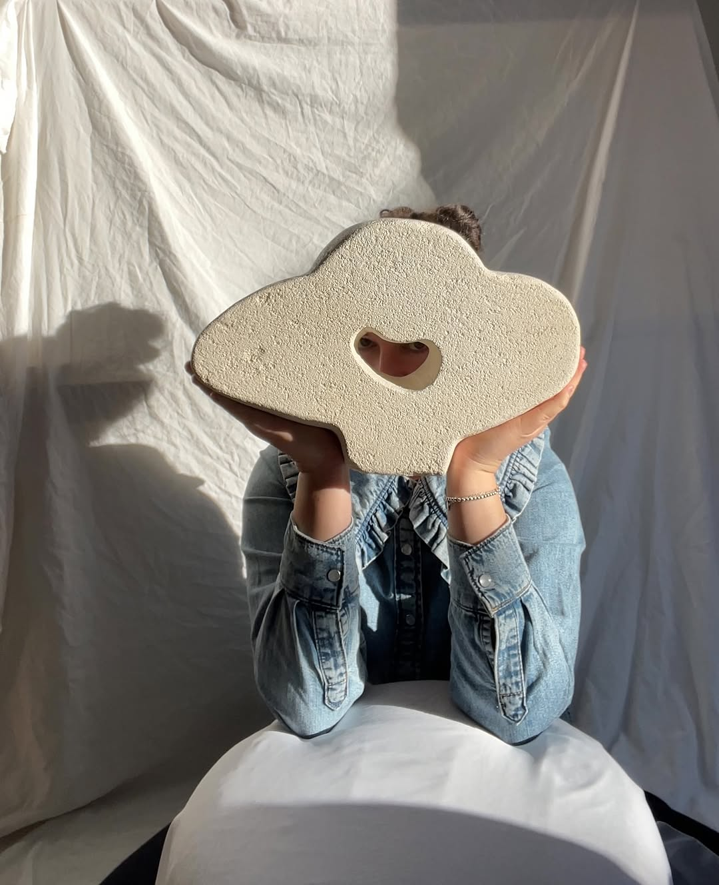
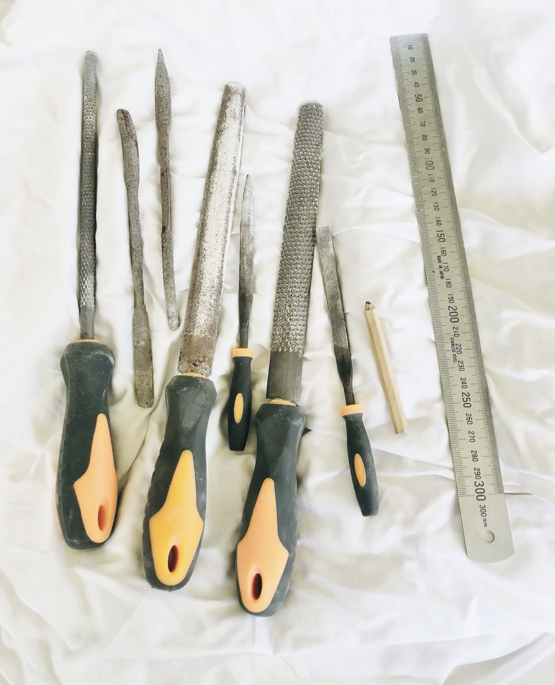

# SEO / Technical Audit — gilaniCollectionTest (evelynmichaelides.com)

**Audit date:** 2026-10-15
**Scope:** `index.html`, `gallery.html`, `selected-works.js`, `gallery.js`, `sanityClient.js`, `styles.css`, `robots.txt`, `sitemap.xml`, plus live response headers for `https://evelynmichaelides.com/`.
**Audience:** This document is written for an autonomous coding agent that will design and implement fixes. Each finding includes exact file/line references, the current code, the technical failure mechanism, evidence, and acceptance criteria. No fixes have been applied yet — this is the problem specification only.

## Site context (read before making any architectural decisions)

- The site is **plain static HTML/CSS/JS** served from the repo root. There is **no build step, no bundler, no SSG framework, and no `package.json` at the repo root**. `find`/`ls` confirm no `wrangler.toml`, no `_headers`/`_redirects`, no `functions/` directory, no CNAME file.
- Live response headers (`curl -D -`) show `server: cloudflare`, `cf-ray`, `cf-cache-status`, `speculation-rules: "/cdn-cgi/speculation"` — the site is served through Cloudflare (most likely Cloudflare Pages pointed directly at this repo with no build command, or a direct-upload deployment). **Confirm the actual deploy mechanism (Cloudflare Pages dashboard build settings, or whatever CI/CD exists) before introducing a build step** — do not assume a specific host API is available.
- Content (gallery artworks) lives in **Sanity CMS** (`sanityClient.js`: `projectId: "g2n6h8e3"`, `dataset: "gallery"`, `useCdn: true`), fetched **client-side, at runtime, in the browser** via `@sanity/client` loaded from `https://esm.sh/@sanity/client@5.4.2` through an import map. There is a separate `sanity/` directory containing the Sanity Studio (CMS admin app) — this is a different app from the public site and should not be confused with it.
- There are two public pages: `index.html` (home) and `gallery.html` (full catalogue). Both pull dynamic gallery content via the same GROQ-query pattern.

---

## Finding 1 — Gallery content does not exist in the initial HTML response (critical crawlability/indexability defect)

**Severity:** Critical
**Category:** Indexability / Rendering

**Files:**
- `index.html:79-80`
- `gallery.html:69-70`
- `selected-works.js` (entire file)
- `gallery.js:62-71, 152-164`

**Current implementation:**

`index.html:79-80`:
```html
<div class="work-grid" id="selected-works" aria-live="polite"></div>
<p class="gallery-empty" id="selected-works-empty" hidden>New selected works coming soon.</p>
```

`gallery.html:69-70`:
```html
<div class="gallery-grid" id="gallery-grid" aria-live="polite"></div>
<p class="gallery-empty" id="gallery-empty" hidden>New works coming soon.</p>
```

Both `<div>` grids are **empty in the HTML source**. Population happens entirely in JS, after `DOMContentLoaded`, via an async Sanity fetch (`selected-works.js:6-38`, `gallery.js:62-71`). If the fetch fails, is slow, or never runs (no JS execution), the `.gallery-empty` `<p>` (currently `hidden`) is the only fallback, and it reads "New selected works coming soon." / "New works coming soon." — i.e., **the empty-state copy, not the real catalogue**.

**Technical failure mechanism:**

1. A plain HTTP GET (`curl`, `wget`, most non-browser HTTP clients, and critically most **crawlers that do not execute JavaScript**) receives HTML with empty grids and hidden "coming soon" paragraphs.
2. Googlebot uses a two-wave indexing process: the raw HTML is indexed first, then the page is queued for a second pass through a headless Chromium renderer (Web Rendering Service) which can take anywhere from seconds to **days**, and is subject to a JS-execution/render budget that is not guaranteed for every page on every crawl.
3. Bing, and essentially all non-Google crawlers relevant to AI-driven discovery (GPTBot/OAI-SearchBot, ClaudeBot, PerplexityBot, Google-Extended, CCBot, Amazonbot, Applebot) either **do not execute JavaScript at all** or have materially weaker/rate-limited rendering than Googlebot. These will see the empty/placeholder state as the actual, final content of the page.
4. Social link-preview scrapers (Facebook, LinkedIn, Slack, iMessage, Discord) also do raw fetches with no JS execution — link previews will show the fallback copy, not artwork.

**Evidence (confirmed live, 2026-10-15):**

A raw fetch of `https://evelynmichaelides.com/` returns, inside the Selected Works section, only: *"New selected works coming soon."* — no artwork titles, images, or descriptions are present anywhere in the raw response. The same is true for `https://evelynmichaelides.com/gallery.html`: the gallery grid section contains only *"New works coming soon."* with no artwork data. This is not a hypothetical — it is the current, live, crawlable state of both pages.

**Why this matters more than a typical JS-rendering caveat:** the artwork catalogue is the entire commercial purpose of this site. If it is not reliably present in the raw HTML, the site's primary value proposition is functionally invisible to search and to most non-Google discovery surfaces, and is at the mercy of Google's rendering queue even for its best-case channel.

**Required fix (direction, not full spec — design is left to the implementing agent):**

The dynamic grids need real markup present in the HTML that is served on first response, not only after a client-side fetch. Acceptable approaches include (not exhaustive):
- A build-time step that queries Sanity (same `projectId`/`dataset`, read-only, same data the client already fetches) and injects server-rendered `<article>` cards into `index.html` / `gallery.html` before deploy, with the existing JS either removed or repurposed to progressively enhance (e.g., add lightbox behavior to the already-present markup) rather than to originate the content.
- A scheduled/CI regeneration (triggered on Sanity publish via webhook, or on a cron, or on every deploy) that re-runs the build step so content stays in sync without requiring a code change per artwork.
- If a client-side-only approach must be kept for some reason, at minimum each page needs non-JS-dependent fallback content with real titles/descriptions (e.g., rendered from a committed JSON snapshot) — this is a materially weaker fix than static generation and should only be used if static generation is ruled out for a concrete, stated reason.

**Must NOT do:** silently swap in a full framework (Next.js/Astro/etc.) migration without flagging it — that is a large architectural change with deployment implications (build command, output directory, Cloudflare Pages settings) and should be called out explicitly as a decision point, not done implicitly as a side effect of "fixing SEO."

**Acceptance criteria:**
- `curl -s https://evelynmichaelides.com/ | grep -i "<title of a real artwork>"` (or equivalent raw fetch) returns actual artwork titles/descriptions, not the "coming soon" fallback, when artworks exist in Sanity.
- Same check passes for `/gallery.html`.
- The fallback "coming soon" copy only appears when the underlying dataset is genuinely empty.

---

## Finding 2 — No structured data (JSON-LD) anywhere on the site

**Severity:** Critical
**Category:** Structured Data / Rich Results / AI-answer-engine visibility

**Files:** `index.html` (full `<head>`, lines 1-25), `gallery.html` (full `<head>`, lines 1-23)

**Current state:** Neither page contains a `<script type="application/ld+json">` block. There is no `Person`, `Organization`, `VisualArtwork`, `ItemList`, `CollectionPage`, or `BreadcrumbList` markup. Confirmed by full read of both `<head>` sections — only standard meta tags and OG tags are present.

**Technical impact:**
- No eligibility for rich results (e.g., artwork carousels, sitelinks search box, breadcrumb trails) in Google Search.
- No structured entity signal for the artist (`Evelyn Michaelides`) as a `Person`/creative professional, which weakens knowledge-graph association and makes disambiguation (vs. other people with similar names) harder for search engines.
- AI answer engines (Google AI Overviews, Perplexity, ChatGPT browsing/search, Claude with web search) rely heavily on structured, unambiguous facts rather than parsing marketing prose to extract entities, relationships, and attributes (artist name, medium, location, individual works). Lack of structured data makes this site a weak source for these surfaces even if the prose content is accurate.

**Required fix:**

Add JSON-LD to `index.html` `<head>` (or end of `<body>`) covering at minimum:
1. `Person` for Evelyn Michaelides — `name`, `jobTitle`/`description` (sculptor), `url`, `image`, `sameAs` (Instagram profile URL `https://instagram.com/evelyn.michaelides`), `address`/`homeLocation` (Melbourne, Australia — already stated in on-page copy at `index.html:66, 92`).
2. `ItemList` or `CollectionPage` for the gallery, with each `ListItem` pointing at a `VisualArtwork` (or `Product` if commissions are meant to be purchasable/offer-bearing — check with the site owner which is intended) entity: `name`, `image`, `description`, `creator` (reference back to the `Person`), `artMedium` (limestone/hebel), `dateCreated` if known.
3. This is **dependent on Finding 1 and Finding 3** — per-artwork structured data is only meaningful once there is a stable, crawlable representation (and ideally a unique URL, see Finding 3) for each artwork to attach it to. Sequence the implementation accordingly: fix the rendering/URL problem first, then attach structured data to the now-real markup, rather than hand-authoring JSON-LD against content that doesn't reliably exist in the HTML.

**Acceptance criteria:**
- Both pages validate in Google's Rich Results Test / Schema.org validator with zero errors.
- The `Person` entity is present on `index.html`.
- Each rendered artwork card has a corresponding `VisualArtwork`/`Product` entity once Finding 1/3 are resolved.

---

## Finding 3 — No unique, crawlable URL per artwork

**Severity:** Critical
**Category:** URL structure / Information architecture

**Files:** `gallery.js:152-230`, Sanity GROQ query at `gallery.js:154`

**Current state:**

The GROQ query already requests a `slug` field that is **fetched but never used**:
```js
// gallery.js:152-164
async function fetchSanityGallery() {
  const query =
    '*[_type == "galleryItem"] | order(order asc, _updatedAt desc) { _id, title, "slug": slug.current, description, dimensions, featured, order, "imageUrl": image.asset->url }';
  ...
}
```
`renderCard` (`gallery.js:166-230`) builds a clickable `<article>` with `role="button"` (`gallery.js:170`) that opens a JS lightbox (`openLightbox`, `gallery.js:73-87`) — it does **not** render an `<a href>` to a dedicated artwork page. The same pattern exists in `selected-works.js:40-77` (`renderCard`) for the homepage's featured items. There is **no route, no page template, and no file** anywhere in the repo that serves an individual artwork by slug.

**Technical impact:**
- Each sculpture has no permalink, so it cannot be:
  - Indexed and ranked independently in Google/Bing web search for its own title or description.
  - Indexed independently in Google Images (which strongly prefers an image's immediate page context to be specifically about that image, not one of forty images in a client-rendered grid).
  - Linked to from an external source (press, Instagram bio link, a collector's blog) in a way that gives that specific piece — rather than just the homepage — any link equity.
  - Shared with a social-preview-correct OG image/title (a shared link currently always resolves to the generic gallery page preview, never the specific piece).
- Past/sold artworks have **no lasting SEO footprint** — once a piece is out of the live Sanity dataset's rendered state, every crawl signal associated with it is gone. A portfolio built entirely as "ephemeral cards in one grid" cannot accumulate authority over time the way a portfolio of permanent per-item pages can.

**Required fix (direction):**

Generate a static (or server-rendered) page per `galleryItem` at a stable path, e.g. `/gallery/<slug>/` or `/works/<slug>.html`, containing:
- A real `<title>` and meta description built from the item's `title`/`description`.
- `` with real `alt` text, `width`/`height`.
- `og:image`/`og:title`/`og:description` specific to that piece (see Finding 5).
- A `VisualArtwork`/`Product` JSON-LD block (Finding 2).
- A canonical `<link rel="canonical">` pointing at itself.
- A link back to the full gallery, and (ideally) to adjacent/related works.

This is naturally produced by the same build step recommended in Finding 1 (if Sanity is queried at build time to produce static gallery markup, producing one page per item instead of one card in a grid is a small extension of the same mechanism, not separate work). **Implement Finding 1 and Finding 3 together** — they share the same root fix.

**Acceptance criteria:**
- Every published `galleryItem` resolves at a stable URL that returns a 200 and contains that item's real title/description/image in the raw HTML.
- Those URLs are discoverable via on-page links (from the grid cards) and are present in `sitemap.xml` (Finding 4).

---

## Finding 4 — Sitemap is minimal, stale, and has no image data

**Severity:** High
**Category:** Crawl discovery

**File:** `sitemap.xml` (full file, 9 lines)

**Current content:**
```xml
<?xml version="1.0" encoding="UTF-8"?>
<urlset xmlns="http://www.sitemaps.org/schemas/sitemap/0.9">
  <url>
    <loc>https://evelynmichaelides.com/</loc>
  </url>
  <url>
    <loc>https://evelynmichaelides.com/gallery.html</loc>
  </url>
</urlset>
```

**Problems:**
1. Only 2 URLs total — once Finding 3 is implemented, every artwork URL must be added here, and this needs to happen automatically (regenerated as part of the same build/deploy step), not by hand per new artwork, or it will immediately go stale again.
2. No `<lastmod>` on either entry — crawlers use this to prioritize re-crawl of changed content; currently there is no signal of recency at all.
3. No `xmlns:image` namespace and no `<image:image>` entries — for an image-heavy visual-art business, an image sitemap is a meaningful, low-cost way to improve Google Images discovery, and is currently entirely absent.
4. `robots.txt:4` correctly points to this sitemap, so the mechanism of discovery is fine — it's the content of the file that's deficient.

**Required fix:**
- Regenerate `sitemap.xml` as part of the same build step as Finding 1/3, enumerating: homepage, gallery index, every per-artwork URL, each with an accurate `<lastmod>` (from Sanity's `_updatedAt`, which the GROQ queries already sort by — see `gallery.js:154`, `selected-works.js:3-4` — but currently discard rather than expose).
- Add the `xmlns:image="http://www.sitemaps.org/schemas/sitemap-image/1.1"` namespace and an `<image:image><image:loc>` entry per artwork image.

**Acceptance criteria:**
- Sitemap entry count tracks the live artwork count (within the freshness window of the regeneration trigger).
- Every `<url>` has a `<lastmod>`.
- Google Search Console's Sitemaps report shows the new image entries being discovered without errors.

---

## Finding 5 — Social preview metadata is generic/incorrect and incomplete

**Severity:** High
**Category:** Social/link-preview metadata (indirect CTR signal)

**Files:** `index.html:10-15`, `gallery.html:10-15`

**Current state, `index.html:10-15`:**
```html
<meta property="og:title" content="Gilani Collection by Evelyn Michaelides">
<meta property="og:description" content="Handmade artisan sculptures crafted from limestone and hebel. Crafted slowly for homes, galleries, and contemplative public spaces. Based in Melbourne, Australia.">
<meta property="og:image" content="https://evelynmichaelides.com/gilanilogo.png">
<meta property="og:url" content="https://evelynmichaelides.com/">
<meta property="og:type" content="website">
<meta property="og:site_name" content="Gilani Collection by Evelyn Michaelides">
```

**Problems:**
1. `og:image` on the homepage is `gilanilogo.png` — a small logo graphic (33,623 bytes) — not the hero artwork image (`gemini-hero.jpg`) or any actual sculpture. Social shares of the homepage will show the logo as the preview thumbnail, which is weak compared to showing an actual piece of art. (`gallery.html:12` correctly uses `gemini-hero.jpg` for its own `og:image` — the homepage is the inconsistent one.)
2. No `twitter:card`, `twitter:title`, `twitter:description`, or `twitter:image` meta tags on either page. Without `twitter:card` (`summary_large_image` is the appropriate value here), X/Twitter and several other platforms that read the Twitter Card tags as a fallback will render degraded or missing previews.
3. Once per-artwork pages exist (Finding 3), each needs its own `og:image`/`og:title`/`og:description` specific to that artwork — currently moot because no such pages exist yet.

**Required fix:**
- Change `index.html:12`'s `og:image` to a real photograph (the hero image or a representative sculpture image), not the logo.
- Add `twitter:card`, `twitter:title`, `twitter:description`, `twitter:image` to both `index.html` and `gallery.html`, mirroring the existing OG values.
- Ensure every per-artwork page generated under Finding 3 has its own correct OG/Twitter tags pointing at that artwork's own image and title.

**Acceptance criteria:** Facebook Sharing Debugger and Twitter Card Validator (or equivalent current tools) show an artwork/hero image and correct title/description for the homepage, gallery page, and at least one generated artwork page.

---

## Finding 6 — Unoptimized images on/near the critical rendering path; missing intrinsic dimensions

**Severity:** High
**Category:** Core Web Vitals (LCP, CLS) / Performance-as-ranking-signal

**Files:** `styles.css:271-280`, `index.html:101, 113, 118`

**Current state:**

`styles.css:271-280` — hero background image, almost certainly the LCP element on the homepage:
```css
.hero {
  position: relative;
  overflow: hidden;
  padding-top: calc(min(12vh, 8rem) + 1rem);
  background: var(--bg);
  background-image: url("gemini-hero.jpg");
  background-size: cover;
  background-position: center;
  background-repeat: no-repeat;
}
```
`gemini-hero.jpg` is 334,638 bytes. It is a single fixed JPEG with no responsive variants (no `image-set()`, no `<picture>`/`srcset` equivalent — CSS `background-image` cannot use `srcset` directly, which is itself part of the problem: a background-image approach structurally prevents responsive image delivery) and no modern-format (WebP/AVIF) alternative. Every visitor on every device downloads the same 334KB file regardless of viewport size or network conditions, directly inflating LCP.

`index.html:101`:
```html

```
`evelynportrait.jpg` is 148,985 bytes. No `width`/`height` attributes are set, so the browser cannot reserve layout space before the image loads, risking a Cumulative Layout Shift as the surrounding `.about__image` box resizes once the image arrives.

`index.html:113` and `index.html:118` (both reference the same image, once for a mobile-only wrapper `.process-tools--mobile` and once for desktop `.process-tools`):
```html

```
`tools.jpeg` is 320,249 bytes, again with no `width`/`height`, and is requested **twice** (once per breakpoint wrapper) even though only one is ever visually shown at a given viewport width — both requests fire regardless of which CSS rule hides the other, unless the browser's `display:none` / media-query-driven loading behaves differently than a naive read suggests; this should be verified, not assumed, since duplicate full-resolution downloads would be a direct, avoidable performance cost.

Also present in the repo root: `original-gemini-hero.png`, 4,806,079 bytes (4.8MB), shown as untracked (`??`) in `git status`. **Before touching this file, confirm with the repo owner whether it is deployed to the live host at all** (it may be a local-only working file that Cloudflare Pages never serves, e.g. if the deploy source is a committed branch and this file was never pushed) — do not delete or move it without that confirmation, since its presence here may be intentional (a kept high-res source for regenerating `gemini-hero.jpg` later, as the git log entry "Use full-resolution source for hero background" suggests was a recent deliberate change).

**Required fix:**
- Produce responsive, modern-format variants of `gemini-hero.jpg` (at minimum a WebP and/or AVIF version, at 2-3 viewport-appropriate sizes) and deliver them via `<picture>`/`srcset` if the hero can be converted from a CSS background-image to an `` (preferred, since it enables responsive loading and is itself a durable fix for the structural limitation noted above), or via CSS `image-set()` with multiple resolutions if the background-image approach must be kept for layout reasons — state which approach was chosen and why.
- Add explicit `width` and `height` attributes to `evelynportrait.jpg` and both `tools.jpeg` instances, matching their rendered aspect ratio, to eliminate CLS risk.
- Verify (e.g., via browser devtools network tab at both a mobile and desktop viewport width) whether both `tools.jpeg` instances actually both download; if so, consolidate to a single `` with CSS-driven sizing rather than two DOM copies, or use `<picture>` with `media` conditions on `<source>` so only one variant is ever fetched.
- Re-encode/compress all four images (`gemini-hero.jpg`, `evelynportrait.jpg`, `tools.jpeg`, `gilanilogo.jpg`) — none should need to exceed roughly 100-150KB at the resolutions actually rendered on screen; current sizes are large relative to typical display dimensions for a logo and for content images behind responsive layout.

**Acceptance criteria:**
- Lighthouse/PageSpeed Insights LCP for `index.html` improves measurably (record before/after score).
- No CLS contribution from `evelynportrait.jpg` or `tools.jpeg` in a Lighthouse run.
- Total image payload for a first homepage visit is reduced from current baseline (record before/after total transferred bytes for images).

---

## Finding 7 — No `rel="preconnect"` for Google Fonts origins

**Severity:** Medium
**Category:** Performance (render-blocking resource)

**Files:** `index.html:23`, `gallery.html` (equivalent stylesheet link — check for the same pattern)

**Current state, `index.html:23`:**
```html
<link rel="stylesheet" href="https://fonts.googleapis.com/css2?family=Manrope:wght@400;600;700&display=swap">
```

This triggers a DNS lookup + TCP + TLS handshake to `fonts.googleapis.com` to fetch the CSS, which then references font files on a **second** origin, `fonts.gstatic.com`, requiring another full connection setup before any font file begins downloading. Neither origin has a `preconnect` hint, so both connection setups happen serially/late rather than being warmed in parallel with the initial document parse.

**Required fix:** Add, before the stylesheet `<link>`:
```html
<link rel="preconnect" href="https://fonts.googleapis.com">
<link rel="preconnect" href="https://fonts.gstatic.com" crossorigin>
```
on both `index.html` and `gallery.html`.

**Acceptance criteria:** Lighthouse no longer flags "Preconnect to required origins" for the Google Fonts hosts.

---

## Finding 8 — `robots.txt` has no explicit policy for AI/LLM crawlers

**Severity:** Medium
**Category:** Crawl policy / AI-visibility decision

**File:** `robots.txt` (full file):
```
User-agent: *
Allow: /

Sitemap: https://evelynmichaelides.com/sitemap.xml
```

**Current state:** The blanket `User-agent: *` / `Allow: /` permits every crawler, including AI-specific ones (`GPTBot`, `OAI-SearchBot`, `ClaudeBot`, `Google-Extended`, `PerplexityBot`, `CCBot`, `Amazonbot`, `Applebot-Extended`), by default, since there is no rule that distinguishes or restricts them.

**This is not inherently a bug** — it may be exactly the desired policy (maximize discoverability across AI answer engines, which is generally desirable for a small business wanting visibility). It is flagged here because the current state is a **default, not a decision** — there is no evidence the site owner considered and chose this deliberately for each crawler category (e.g., some site owners specifically want to opt out of `Google-Extended` for AI training purposes while remaining fully crawlable for classic Search, which requires a separate explicit rule since `Google-Extended` is a distinct token from `Googlebot`).

**Required action:** Not a code fix — a decision the implementing agent should surface to the site owner rather than resolve unilaterally: confirm whether the current blanket-allow posture is intentional, and if any specific AI crawler should be restricted, add an explicit `User-agent:` block for it rather than relying on silence.

---

## Finding 9 — Missing hardening response headers on the live origin

**Severity:** Medium (indirect SEO signal; primarily a security/trust item, included because the originating audit framework treats it as part of technical SEO)

**Evidence:** `curl -s -D - -o /dev/null https://evelynmichaelides.com/` response headers (captured 2026-10-15):
```
HTTP/2 200
content-type: text/html; charset=utf-8
x-content-type-options: nosniff
referrer-policy: strict-origin-when-cross-origin
access-control-allow-origin: *
server: cloudflare
```

**Missing:** `Content-Security-Policy`, `Strict-Transport-Security` (HSTS), `X-Frame-Options` (or equivalent `frame-ancestors` in a CSP). Cloudflare's platform defaults do not automatically add these for all zones/configurations — they typically require an explicit Transform Rule, a `_headers` file (Cloudflare Pages convention), or a Worker.

**Also notable:** `access-control-allow-origin: *` is present on the base HTML document response. A wildcard CORS header on the document itself is unusual (CORS headers are normally relevant for fetched sub-resources/APIs, not the top-level HTML document) and worth the implementing agent double-checking the origin/platform configuration that's producing it, since it may be a Cloudflare-level default rather than anything this repo controls.

**Required fix:** Determine where response headers are actually configured (Cloudflare Pages `_headers` file — note none exists in this repo currently — vs. dashboard-level Transform Rules vs. a Worker) before implementing, since adding a `_headers` file only works if the live deployment is actually a Cloudflare Pages project reading from this repo; confirm this first (see "Site context" section above). Then add `Strict-Transport-Security: max-age=63072000; includeSubDomains; preload`, a reasonable `Content-Security-Policy` (must explicitly allow the existing third-party origins already in use: `www.googletagmanager.com`, `fonts.googleapis.com`, `fonts.gstatic.com`, `esm.sh`, `*.sanity.io`/`cdn.sanity.io`, `formspree.io`), and `X-Frame-Options: DENY` or `frame-ancestors 'none'` in the CSP.

---

## Finding 10 — Minor: favicon/manifest completeness

**Severity:** Low
**Category:** Polish (minimal direct SEO impact)

**File:** `index.html:9`, `gallery.html:9`
```html
<link rel="icon" type="image/png" href="gilanilogo.png">
```
No `apple-touch-icon`, no `manifest.json` (web app manifest). Does not block indexing or rankings; included for completeness since it affects bookmark/home-screen presentation, which is adjacent to brand-presence signals.

**Required fix (optional/low priority):** Add an `apple-touch-icon` link and a minimal web manifest if the site owner wants home-screen/PWA-style presentation polish. Not required for core SEO health.

---

## Summary table

| # | Finding | Severity | Primary files |
|---|---|---|---|
| 1 | Gallery content absent from raw HTML (JS-only rendering) | Critical | `index.html:79-80`, `gallery.html:69-70`, `selected-works.js`, `gallery.js` |
| 2 | No JSON-LD structured data | Critical | `index.html` head, `gallery.html` head |
| 3 | No unique URL per artwork (unused `slug` field) | Critical | `gallery.js:152-230` |
| 4 | Sitemap minimal/stale, no `lastmod`, no image entries | High | `sitemap.xml` |
| 5 | Social preview metadata generic/incomplete (wrong `og:image`, no Twitter Card tags) | High | `index.html:10-15`, `gallery.html:10-15` |
| 6 | Unoptimized hero/content images, no intrinsic dimensions | High | `styles.css:271-280`, `index.html:101,113,118` |
| 7 | No `preconnect` for Google Fonts | Medium | `index.html:23` |
| 8 | No explicit AI-crawler policy in `robots.txt` | Medium | `robots.txt` |
| 9 | Missing CSP/HSTS/X-Frame-Options on live origin | Medium | (origin/platform config, not in-repo) |
| 10 | No apple-touch-icon/manifest | Low | `index.html:9`, `gallery.html:9` |

**Dependency note for sequencing:** Findings 2 and 4 both depend on Finding 1/3 being resolved first (structured data and sitemap entries need real, stable, per-artwork markup/URLs to attach to). Resolve 1 and 3 together as the foundational fix, then layer 2 and 4 on top.
